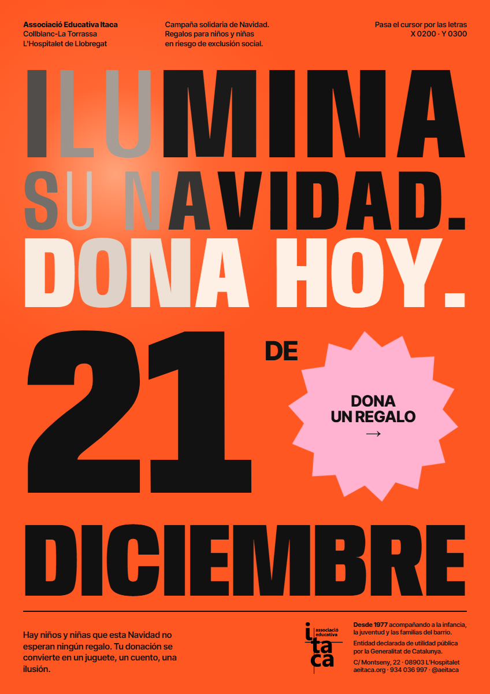

# Ilumina su Navidad

Cartel digital interactivo (848 × 1200 px) para la campaña de Navidad de la **Associació Educativa Itaca** (L'Hospitalet):
donaciones para comprar regalos a niños y niñas en riesgo de exclusión social. **21 de diciembre.**

Actividad 0612 · THE INTERACTIVE POSTER · Desarrollo web en entorno cliente.
Hecho con HTML, CSS y JavaScript, sin librerías ni frameworks.

**Web:** https://posternavidad.vercel.app



## Concepto

El cartel sigue el lenguaje de los carteles recogidos en [The Moving Poster](https://themovingposter.com/):
tipografía gigante que es la propia imagen, tres tintas planas (naranja, negro y crema, con un acento rosa)
y la información pequeña ordenada en columnas, como en el cartel suizo.

La idea es literal: **tu gesto ilumina**. Las letras del lema son pesadas y oscuras. Donde pasa el cursor
llega una luz que las aligera: pierden peso y se vuelven claras. Así el mensaje _Ilumina su Navidad_
ocurre en el propio cartel. La estrella de Navidad rosa es el botón de donar: al acercarse, crece, gira y se enciende.

Tipografías: **Anybody**, una fuente variable con ejes de peso (100–900) y anchura (50–150), para el texto
grande; **Inter Tight** para los textos pequeños.

## Estructura

```
├── index.html      Estructura semántica del cartel
├── style.css       Variables, reset, composición y transiciones
├── main.js         Tipografía cinética, eventos e interacciones
├── img/logos/      Logos oficiales de las entidades
└── captura/        Capturas del cartel
```

`main.js` está ordenado en diez bloques: configuración, referencias al DOM, estado, cálculos (funciones puras),
preparación de la tipografía, pintado, `mousemove`, `mouseenter`/`mouseleave`, escalado e inicio.
Todos los `addEventListener` están juntos en `iniciarCartel()`.

Al cargar, `prepararTipografia()` parte cada fila del texto en una `<span>` por letra (el texto completo queda en
`aria-label`) y calcula el tamaño de letra con el que cada fila llena su ancho exacto (`ajustarFilaAlAncho()`).

**No hay ninguna regla `:hover` en el CSS.** Las transiciones están en `style.css`, pero quien las dispara es siempre JavaScript.

## Eventos de JavaScript

| Evento | Elemento | Función | Qué hace |
| --- | --- | --- | --- |
| `mousemove` | `#cartel` | `seguirCursor` | Las letras cercanas al cursor pierden peso y se iluminan; una luz sigue al cursor |
| `mouseleave` | `#cartel` | `soltarCursor` | Las letras recuperan su peso y la luz se apaga |
| `mouseenter` | `#estrella` | `encenderEstrella` | La estrella crece, gira y pasa de rosa a crema |
| `mouseleave` | `#estrella` | `apagarEstrella` | La estrella vuelve a su tamaño, giro y color iniciales |
| `resize` | `window` | `ajustarEscala` | Reduce el cartel entero si la ventana es más pequeña, sin deformarlo |

## Las tres interacciones

### 1 · `mouseenter`: la estrella se enciende

Al entrar el cursor en la estrella, `encenderEstrella()` llama a `aplicarEstadoEstrella()`, que modifica desde
JavaScript **dos propiedades visuales**:

```js
estrella.style.transform = "scale(1.14) rotate(-12deg)";  // crece y gira
poligonoEstrella.style.fill = "#fff1e6";                   // de rosa a crema
```

La entrada es rápida y con un pequeño rebote.

### 2 · `mouseleave`: vuelve al estado inicial

`apagarEstrella()` usa la misma función con el estado de reposo: `scale(1) rotate(0deg)` y el rosa original.
La salida es más lenta y sin rebote, así que entrada y salida se distinguen.

### 3 · `mousemove`: tipografía cinética

`seguirCursor()` convierte `clientX`/`clientY` a coordenadas del cartel con `getBoundingClientRect()`, de modo que
el punto va de (0, 0) a (848, 1200) aunque el cartel esté escalado. Después, en cada fotograma
(`requestAnimationFrame`), para cada letra:

1. Se mide la distancia entre su centro y el cursor.
2. `calcularInfluencia()` la convierte en un valor de 0 a 1: 1 justo debajo del cursor y 0 a partir de 240 px,
   con una curva _smoothstep_ para que el cambio empiece y acabe suave.
3. La influencia se acerca poco a poco a ese valor (`interpolar()`), lo que da inercia al movimiento.
4. `pintarLetra()` aplica el resultado a **dos propiedades**: el peso de la fuente variable
   (`font-variation-settings`, de 900 a 140) y el color (`mezclarColor()`, de negro a crema; las letras crema de
   «Dona hoy.» hacen lo contrario).

Cada fila reparte sus letras a lo ancho, así que cuando unas adelgazan el resto se reacomoda y la palabra se mueve.
El bucle se detiene solo cuando todo ha llegado a su valor, para no gastar recursos con el cartel quieto.
La cabecera muestra en directo las coordenadas que usa el cartel (`X 0424 · Y 0600`).

## Cómo ejecutarlo

Abrir `index.html` en el navegador. No necesita servidor ni instalación; solo conexión para cargar las fuentes de Google Fonts.

## La entidad y el branding

El enunciado la llama «Fundación ITACA», pero su nombre oficial es **Associació Educativa Itaca**. Es una
asociación sin ánimo de lucro de Collblanc-La Torrassa (L’Hospitalet de Llobregat), declarada de utilidad
pública por la Generalitat de Catalunya. Desde 1977 trabaja en la educación en el tiempo libre de niños,
niñas, jóvenes y familias. El cartel usa el nombre oficial.

El pie del cartel incluye:

- El **logotipo oficial** (`img/logos/itaca-associacio-educativa.png`, descargado de aeitaca.org). El original es
  blanco sobre transparente y se imprime en negro con `filter: brightness(0)`, como una tinta más del cartel.
- La declaración de **utilidad pública** como sello de la entidad.
- Dirección y contacto: C/ Montseny, 22 · 08903 L’Hospitalet · aeitaca.org · 934 036 997 · @aeitaca.

La estrella enlaza a la página de donativos de la entidad: https://aeitaca.org/haz-un-donativo/

Fuente de toda la información: https://aeitaca.org/
