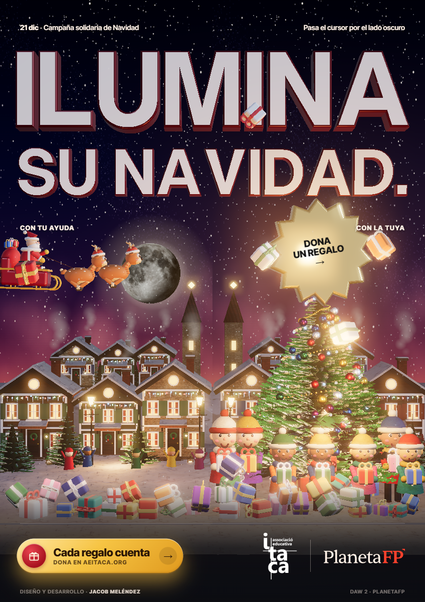
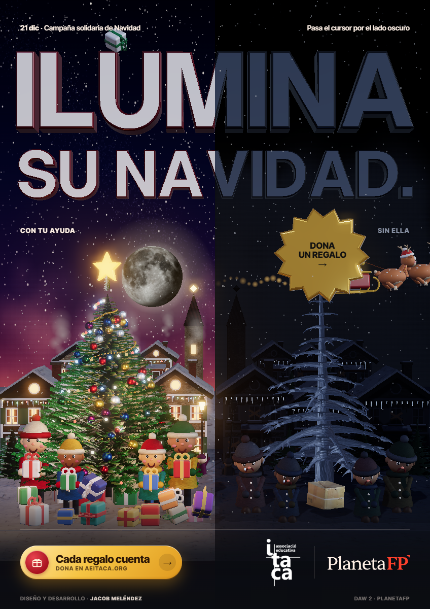

# Ilumina su Navidad

Cartel digital interactivo en 3D (848 × 1200 px) para la campaña de Navidad de la **Associació Educativa Itaca**
(L'Hospitalet): donaciones para comprar regalos a niños y niñas en riesgo de exclusión social. **21 de diciembre.**

Actividad 0612 · THE INTERACTIVE POSTER · Desarrollo web en entorno cliente.
Diseño y desarrollo: **Jacob Meléndez** · DAW 2 · PlanetaFP.

- **Web:** https://posternavidad.vercel.app
- **Repositorio:** https://github.com/jacobmelendezjm-tech/Poster-Navidad



## Concepto

**Dos Navidades en la misma ciudad, la misma noche.** A la izquierda, un pueblo navideño iluminado, un abeto lleno de
luces y niños felices con sus regalos. A la derecha, el mismo pueblo a oscuras, un pino seco y los mismos niños
sentados en la nieve, tristes y sin regalos. El lema **«Ilumina su Navidad»** se parte por la mitad: iluminado en el
lado feliz y apagado en el oscuro.

La idea es que **el gesto del usuario es la donación**: su cursor es una luz que alumbra el lado oscuro, y al pulsar
la estrella de **«Dona un regalo»** la Navidad cruza al otro lado. Si deja de donar, todo vuelve a congelarse. El
contraste busca concienciar y animar a donar.

Detalles que acompañan:

- **Apertura:** mientras carga, una tormenta de nieve tapa el cartel; al terminar la tormenta amaina poco a poco
  (se despeja la niebla y se calma la nieve) y deja ver el cartel.
- **Santa Claus** vuela de ida y vuelta por el cielo (gira en cada extremo) soltando regalos; en el lado oscuro solo
  los suelta mientras se dona.
- **Los regalos 3D** caen con física real, se apilan y, al hacer click, estallan en confeti y fuegos artificiales.
- **La nieve** cae y se acumula; la luna es el mapa real de la superficie lunar (NASA).



## Las tres interacciones

### 1 · `mousemove` sobre el cartel: la luz del cursor

`seguirCursor()` convierte la posición del ratón en píxeles del cartel (con `getBoundingClientRect()`, para que
funcione aunque el cartel esté escalado) y en cada fotograma:

- mueve una **luz cálida 3D** que alumbra el lado oscuro;
- las **letras del lema** cercanas se adelantan y giran hacia la luz como un muelle (y vuelven con un rebote al irse);
- un **niño triste** bajo el cursor se levanta, recupera el color, sonríe y recibe un regalo;
- un **niño feliz** bajo el cursor salta y lanza su regalo al aire.

`mouseleave` en el cartel apaga la luz y devuelve las letras a su sitio.

### 2 · `mouseenter` en «Dona un regalo»: donar

`encenderEstrella()`:

- el botón cambia **dos propiedades visuales desde JavaScript** (`aplicarEstadoBoton()`): `transform` (crece y
  gira) y `color` del texto; al salir (interacción 2) recupera los valores iniciales con una transición más lenta;
- la estrella dorada crece y gira;
- los niños felices **cargan el árbol y los regalos y cruzan corriendo** al lado oscuro;
- el lado oscuro **se calienta como un amanecer**: cambia el cielo, se encienden ventanas y farolas, la nieve se
  vuelve blanca y el lema se ilumina entero;
- los niños tristes **se levantan uno detrás de otro** y empiezan a llover regalos;
- la etiqueta «Sin ella» se funde en «Con la tuya».

### 3 · `mouseleave` de «Dona un regalo»: sin donación todo se congela

`apagarEstrella()`:

- la caravana **vuelve a casa** con el árbol;
- los regalos del lado oscuro **se convierten en hielo** y caen al suelo, donde no se pueden abrir;
- los niños **se sientan y lloran** (sollozan y les caen lágrimas).

## Eventos de JavaScript

| Evento | Elemento | Función | Qué hace |
| --- | --- | --- | --- |
| `mousemove` | `#cartel` | `seguirCursor` | Luz del cursor, letras, niños tristes y felices |
| `mouseleave` | `#cartel` | `soltarCursor` | Apaga la luz y las letras vuelven |
| `mouseenter` | `#donar` | `encenderEstrella` | Donar: caravana, amanecer, niños felices, lluvia de regalos |
| `mouseleave` | `#donar` | `apagarEstrella` | Dejar de donar: vuelve la caravana, hielo y llanto |
| `click` | `#cartel` | `pulsarCartel` | El regalo 3D pulsado (`Raycaster`) estalla en confeti y fuegos |
| `touchstart` / `touchmove` / `touchend` | `#cartel`, `#donar` | `tocarCartel`… | En móviles el dedo hace de cursor; la estrella se enciende con el primer toque y abre la web de donativos con el segundo |
| `resize` | `window` | `ajustarEscala` | Escala el cartel a la ventana sin deformarlo |
| `visibilitychange` | `document` | `reanudar` | Pausa el dibujo con la pestaña oculta y lo reanuda al volver |

No hay ninguna regla `:hover` en el CSS: los cambios los dispara JavaScript.

## Cómo está hecho

```
├── index.html      Lienzo 3D, textos, botón de donar, pie con logos y pantalla de carga (tormenta de nieve)
├── style.css       Posición de los textos, tormenta de nieve de la apertura, escalado
├── main.js         Escena 3D e interacción (módulo ES)
├── servidor.js     Servidor local para verlo (node servidor.js)
├── assets/         HDRI, texturas y modelos 3D (Poly Haven, CC0) y mapa lunar (NASA)
├── img/logos/      Logos de Itaca y PlanetaFP
└── captura/        Capturas del cartel
```

- **HTML, CSS y JavaScript**, sin frameworks. La escena 3D usa **Three.js** (WebGL) y la física de los regalos
  **cannon-es**, cargados desde CDN con un `importmap`.
- **Cámara calculada** para que el plano z = 0 mida exactamente 848 × 1200 px: cada objeto se coloca en el píxel
  del cartel que le corresponde.
- **Materiales con dos colores** (frío y cálido) que se mezclan según la «calidez» del lado oscuro al donar.
- **Lema partido** con un pequeño sombreador: la parte de cada letra que cae a la derecha de la línea central se
  pinta apagada.
- **Niños articulados** (piernas, brazos y cabeza con bisagras) con un valor de alegría que mueve pose, cara y color.

### Rendimiento

El cartel se muestra también dentro de la web de pósters de la clase (en un `iframe`), así que:

- dibuja solo los píxeles que ocupa en pantalla y sube la resolución al ampliarlo;
- **se detiene** cuando no está visible (`IntersectionObserver`) o la pestaña está oculta;
- no descarga sus texturas hasta que el usuario llega a él;
- ajusta la calidad si el equipo va justo; texturas ligeras (512 px).

## Cómo ejecutarlo

Abrir https://posternavidad.vercel.app en cualquier navegador.

En local hace falta un servidor (los módulos ES no se cargan desde `file://`) y conexión para Three.js:

```
node servidor.js
```

y abrir http://localhost:8765.

## Créditos

- HDRI, texturas y modelos de [Poly Haven](https://polyhaven.com) (CC0): `kloppenheim_02_puresky`, `snow_02`,
  `castle_brick_02_white`, `clay_roof_tiles_02`, `dark_wooden_planks`, `street_lamp_01`, `Lantern_01`,
  `cardboard_box_01`.
- Mapa de la superficie de la Luna: NASA Scientific Visualization Studio, *CGI Moon Kit* (LRO / LROC), dominio
  público.
- Logotipo de la Associació Educativa Itaca (aeitaca.org) y de PlanetaFP (planetafp.es).
- El botón de donar enlaza a https://aeitaca.org/haz-un-donativo/.
