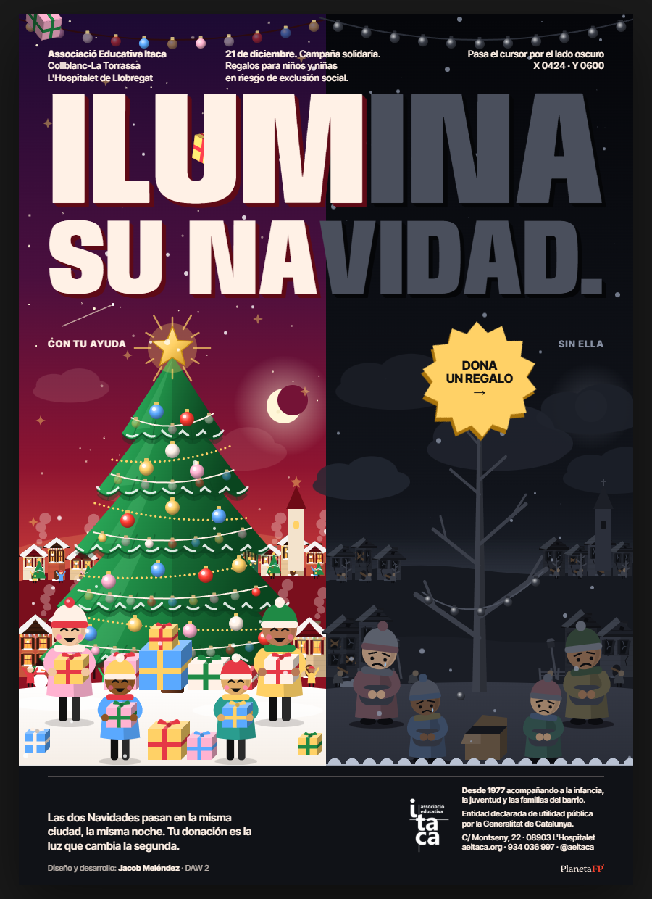
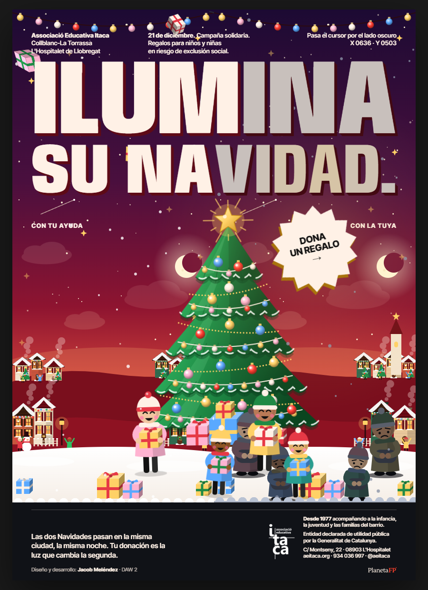

# Ilumina su Navidad

Cartel digital interactivo (848 × 1200 px) para la campaña de Navidad de la **Associació Educativa Itaca** (L'Hospitalet):
donaciones para comprar regalos a niños y niñas en riesgo de exclusión social. **21 de diciembre.**

Actividad 0612 · THE INTERACTIVE POSTER · Desarrollo web en entorno cliente.
Hecho con HTML, CSS y JavaScript, sin librerías ni frameworks.

**Web:** https://posternavidad.vercel.app





## Concepto

**Dos Navidades, una al lado de la otra.** A la izquierda, la Navidad que todos imaginamos: un árbol verde y
frondoso, luces que parpadean y dos niños felices con sus regalos. A la derecha, la misma escena para quien no
tiene nada: un árbol seco, una guirnalda apagada, nieve fría y los mismos dos niños, tristes y sin regalos.

El cursor es la donación: **donde pasa, el lado oscuro se ilumina** y aparece la Navidad feliz (árbol verde,
regalos, sonrisas). Al llegar a la estrella de donar, la estrella que le falta al árbol seco, la luz se abre por
todo el lado oscuro y la etiqueta «Sin ella» pasa a «Con la tuya». El objetivo es concienciar y empujar a donar.

Técnica: la escena es un SVG dibujado a mano. Sobre el lado oscuro hay una copia (`<use>`) de la escena feliz
con una máscara (`#mascara-luz`): un círculo con borde degradado que `main.js` mueve y agranda en cada fotograma.

### Profundidad y 3D

Sin librerías, solo CSS y SVG:

- **Regalos 3D que caen girando**: cubos de CSS 3D (`transform-style: preserve-3d`, seis caras con luz distinta).
  En el lado oscuro solo caen cuando el cursor está sobre la estrella de donar.
- **Paralaje 3D**: el punto de vista (`perspective-origin`) de los regalos que caen sigue al cursor. El cartel en sí
  no se mueve, para que la posición del cursor coincida siempre con lo que se ve.
- **Lema con relieve**: cada letra se extruye con sombras apiladas; en el lado oscuro la extrusión es negra.
- **Volumen en la escena**: bolas y bombillas con brillo (degradados radiales), árbol con luz lateral,
  regalos en perspectiva isométrica y estrella de donar con canto y sombra.

La escena tiene cuatro niños por lado: de pie y con regalos en la Navidad feliz; sentados en el suelo, sin regalos
y junto a una caja vacía en la oscura. El pie es una franja fija que la luz nunca tapa, para que siempre se lea.

### Niños que saltan y cosas que se acumulan

- **Al pasar el cursor por un niño feliz**, salta y lanza su regalo, que sube girando y vuelve a sus manos cuando
  ya ha aterrizado (`comprobarNinos()` en `mousemove`; animaciones `saltar` y `lanzar-regalo`). 
- **Al pasar el cursor por un niño triste**, se levanta él mismo: el cuerpo sube con un rebote, las piernas se
  estiran, la cabeza se endereza, los colores apagados se vuelven vivos, la cara pasa de triste a sonriente y le cae
  un regalo en las manos. Todo son transiciones CSS (incluido el trazado de los brazos, con la propiedad `d`), así
  que al irse el cursor sigue feliz 2,6 s y luego se vuelve a sentar despacio. Al donar se levantan todos. Por eso
  la copia iluminada del lado oscuro no incluye a los niños: van en su propia capa, por encima de la luz.
- **Los regalos 3D caen y se apilan** en el suelo: `main.js` los mueve con su propio bucle y guarda un mapa de alturas
  por columnas; cada regalo reserva su hueco al empezar a caer, así la pila crece pareja y no tapa a los niños.
  En el lado oscuro solo llueven regalos con el cursor sobre la estrella, y se quedan: cada donación se acumula.
- **La nieve se acumula**: cada copo que llega al suelo (`animationiteration`) engorda un manto de nieve en cada lado.

### Regalos que estallan, hielo y pueblo

- **Click en un regalo 3D**: estalla en confeti y lanza cohetes que explotan en palmeras de chispas (un `<canvas>`
  encima del cartel; el bucle solo corre mientras quedan partículas). Los regalos que estaban encima caen a ocupar
  el hueco.
- **Al donar** la luz se abre despacio desde la estrella, la etiqueta cambia con un fundido y los niños se levantan
  uno detrás de otro, primero los más cercanos.
- **Al dejar de donar** el lado oscuro se congela: los regalos se quedan helados donde estén (también en el aire,
  cubiertos de escarcha y sin poder abrirse) y los niños se sientan y lloran a lágrima viva. Al volver a la estrella
  el hielo se derrite y todo sigue.
- **El fondo es un pueblo**: en el lado feliz, casas con ventanas encendidas, humo, coronas, luces, iglesia con
  estrella, farolas, muñeco de nieve y gente con los brazos en alto; en el lado oscuro, el mismo pueblo desolado,
  tapiado, sin luz y con gente encorvada. La luz del cursor convierte uno en el otro.

### Rendimiento

En cada `mousemove` solo se tocan propiedades que no se heredan: el halo se mueve con `transform`/`opacity` y la
capa iluminada recibe su `mask-image` directamente. Usar variables CSS en el contenedor obligaba a recalcular los
estilos de cientos de elementos de la ilustración en cada fotograma (bajaba a unos 30 fps). La escena fija va en su
propia capa (`will-change`) y la nieve cae en una capa HTML aparte, así la ilustración no se redibuja.

### Lenguaje gráfico

El cartel sigue el lenguaje de los carteles recogidos en [The Moving Poster](https://themovingposter.com/):
tipografía gigante que es la propia imagen, colores planos que parten el cartel en dos (rojo navideño y oro frente a azul noche y gris)
y la información pequeña ordenada en columnas, como en el cartel suizo.

La idea es literal: **tu gesto ilumina**. Las letras del lema son pesadas y oscuras. Donde pasa el cursor
llega una luz que las aligera: pierden peso y se vuelven claras. Así el mensaje _Ilumina su Navidad_
ocurre en el propio cartel. La estrella de Navidad rosa es el botón de donar: al acercarse, crece, gira y se enciende.

Tipografías: **Anybody**, una fuente variable con ejes de peso (100–900) y anchura (50–150), para el texto
grande; **Inter Tight** para los textos pequeños.

## Estructura

```
├── index.html      Estructura semántica del cartel
├── style.css       Variables, reset, composición y transiciones
├── main.js         Tipografía cinética, eventos e interacciones
├── img/logos/      Logos oficiales de las entidades
└── captura/        Capturas del cartel
```

`main.js` está ordenado en diez bloques: configuración, referencias al DOM, estado, cálculos (funciones puras),
preparación de la tipografía, pintado, `mousemove`, `mouseenter`/`mouseleave`, escalado e inicio.
Todos los `addEventListener` están juntos en `iniciarCartel()`.

Al cargar, `prepararTipografia()` parte cada fila del texto en una `<span>` por letra (el texto completo queda en
`aria-label`) y calcula el tamaño de letra con el que cada fila llena su ancho exacto (`ajustarFilaAlAncho()`).

**No hay ninguna regla `:hover` en el CSS.** Las transiciones están en `style.css`, pero quien las dispara es siempre JavaScript.

## Eventos de JavaScript

| Evento | Elemento | Función | Qué hace |
| --- | --- | --- | --- |
| `mousemove` | `#cartel` | `seguirCursor` | Las letras cercanas al cursor pierden peso y se iluminan; el círculo de luz enciende el lado oscuro |
| `mouseleave` | `#cartel` | `soltarCursor` | Las letras recuperan su peso y la luz se apaga |
| `mouseenter` | `#estrella` | `encenderEstrella` | La estrella crece, gira y pasa de rosa a crema; todo el lado oscuro se ilumina |
| `mouseleave` | `#estrella` | `apagarEstrella` | La estrella vuelve a su tamaño, giro y color iniciales |
| `resize` | `window` | `ajustarEscala` | Reduce el cartel entero si la ventana es más pequeña, sin deformarlo |

## Las tres interacciones

### 1 · `mouseenter`: la estrella se enciende

Al entrar el cursor en la estrella, `encenderEstrella()` llama a `aplicarEstadoEstrella()`, que modifica desde
JavaScript **dos propiedades visuales**:

```js
estrella.style.transform = "scale(1.14) rotate(-12deg)";  // crece y gira
poligonoEstrella.style.fill = "#fff1e6";                   // de rosa a crema
```

La entrada es rápida y con un pequeño rebote.

### 2 · `mouseleave`: vuelve al estado inicial

`apagarEstrella()` usa la misma función con el estado de reposo: `scale(1) rotate(0deg)` y el rosa original.
La salida es más lenta y sin rebote, así que entrada y salida se distinguen.

### 3 · `mousemove`: tipografía cinética

`seguirCursor()` convierte `clientX`/`clientY` a coordenadas del cartel con `getBoundingClientRect()`, de modo que
el punto va de (0, 0) a (848, 1200) aunque el cartel esté escalado. Después, en cada fotograma
(`requestAnimationFrame`), para cada letra:

1. Se mide la distancia entre su centro y el cursor.
2. `calcularInfluencia()` la convierte en un valor de 0 a 1: 1 justo debajo del cursor y 0 a partir de 240 px,
   con una curva _smoothstep_ para que el cambio empiece y acabe suave.
3. La influencia se acerca poco a poco a ese valor (`interpolar()`), lo que da inercia al movimiento.
4. `pintarLetra()` aplica el resultado a **dos propiedades**: el peso de la fuente variable
   (`font-variation-settings`, de 900 a 140) y el color (`mezclarColor()`, a dorado; las letras del lado oscuro parten apagadas y se encienden).

Cada fila reparte sus letras a lo ancho, así que cuando unas adelgazan el resto se reacomoda y la palabra se mueve.
El bucle se detiene solo cuando todo ha llegado a su valor, para no gastar recursos con el cartel quieto.
La cabecera muestra en directo las coordenadas que usa el cartel (`X 0424 · Y 0600`).

## Cómo ejecutarlo

Abrir `index.html` en el navegador. No necesita servidor ni instalación; solo conexión para cargar las fuentes de Google Fonts.

## La entidad y el branding

El enunciado la llama «Fundación ITACA», pero su nombre oficial es **Associació Educativa Itaca**. Es una
asociación sin ánimo de lucro de Collblanc-La Torrassa (L’Hospitalet de Llobregat), declarada de utilidad
pública por la Generalitat de Catalunya. Desde 1977 trabaja en la educación en el tiempo libre de niños,
niñas, jóvenes y familias. El cartel usa el nombre oficial.

El pie del cartel incluye:

- El **logotipo oficial** (`img/logos/itaca-associacio-educativa.png`, descargado de aeitaca.org). El original es
  blanco sobre transparente y se usa tal cual sobre el lado oscuro; cuando todo se enciende pasa a negro con `filter: brightness(0)`.
- La declaración de **utilidad pública** como sello de la entidad.
- Dirección y contacto: C/ Montseny, 22 · 08903 L’Hospitalet · aeitaca.org · 934 036 997 · @aeitaca.

La estrella enlaza a la página de donativos de la entidad: https://aeitaca.org/haz-un-donativo/

Fuente de toda la información: https://aeitaca.org/

## Autoría

Diseño y desarrollo: **Jacob Meléndez** · DAW 2 · PlanetaFP.
Logo de PlanetaFP descargado de planetafp.es (`img/logos/planetafp.svg`; `planetafp-blanco.svg` es la versión
en crema para el fondo oscuro).
